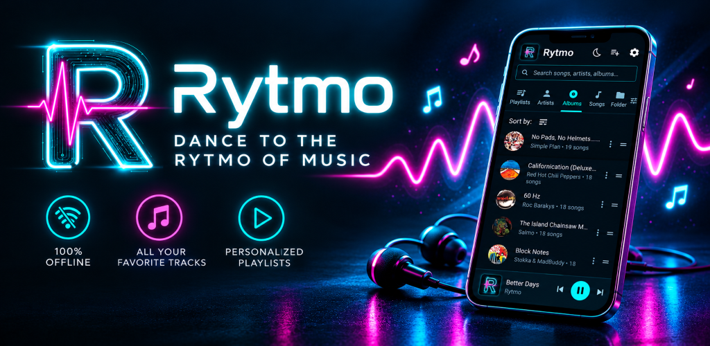
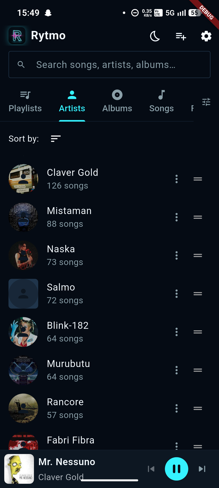
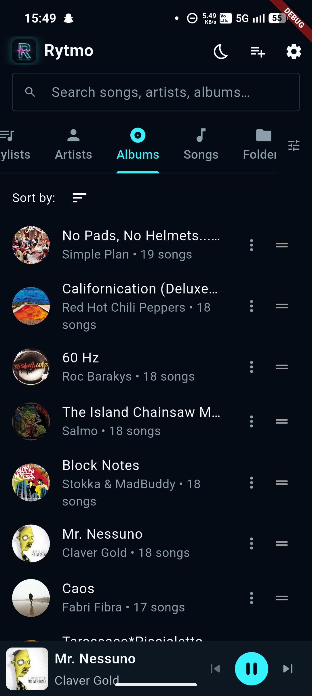
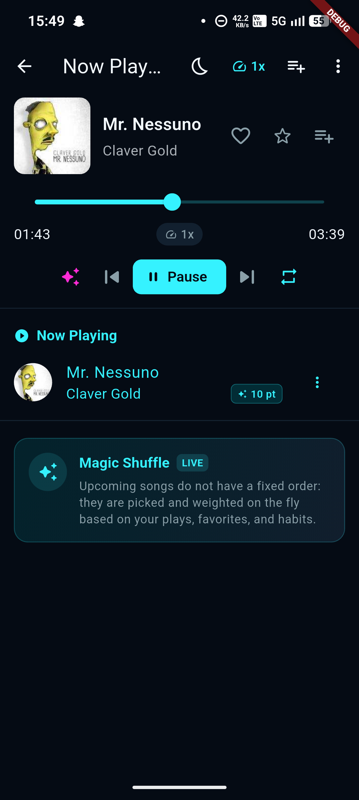
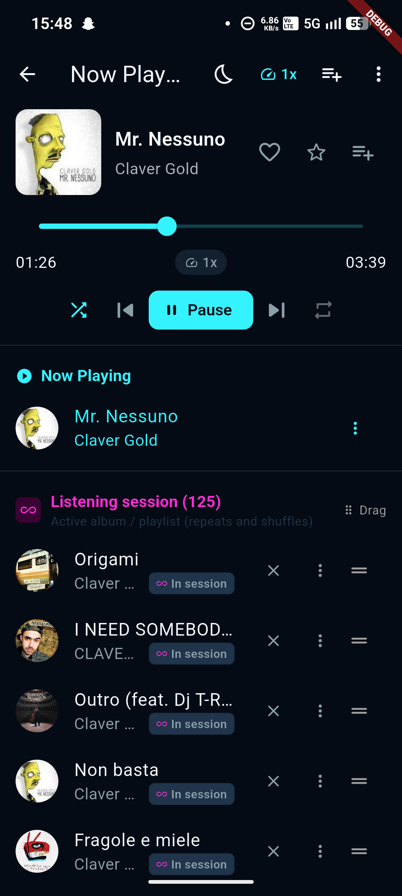

  

  # Rytmo Music Player
  ### Powerful offline music player with smart shuffle, audio tag editor & themes.

  
  
  
  

  

    <b>Feedback & Issue Tracking Hub</b> 
    Help us shape the future of Rytmo Music Player by sharing bugs, ideas, and feature requests.
  

  

    <a href="#-about-rytmo">About</a> •
    <a href="#-features">Features</a> •
    <a href="#-screenshots">Screenshots</a> •
    <a href="#-feedback--bug-reports">Report an Issue</a> •
    <a href="#-privacy">Privacy</a>
  

  

---

## 🎵 About Rytmo

**Rytmo Music Player** is a modern, fast, and privacy-first offline music player built with Flutter and Material 3 design principles. Designed for music lovers who keep their library locally, Rytmo offers seamless playback, smart audio curation, and a distraction-free experience—**zero ads, zero tracking, and 100% offline**.

---

## ✨ Features

- 🎧 **Pure Offline Playback**: Wide audio format support (MP3, FLAC, WAV, M4A, OGG, AAC) with smooth audio output and lock-screen / notification controls.
- 🪄 **Magic Shuffle**: An intelligent shuffle algorithm that prevents repetitive tracks and harmonizes your playback queue based on listening habits.
- 🏷️ **Built-in Tag & Artwork Editor**: Edit title, artist, album, genre, track numbers, and replace album artwork directly from your device.
- 📂 **Flexible Library Navigation**: Browse your songs by Tracks, Playlists, Folders (tree or flat hierarchy), Artists, Albums, and Genres.
- 🔗 **Spotify Playlist Matching**: Import Spotify tracklists and automatically match them with your local library.
- ⏱️ **Smart Sleep Timer**: Fall asleep to your favorite music with timer options including "Finish Current Song before pausing".
- 🎨 **Sleek Material 3 Interface**: Dynamic Dark and Light themes with customizable tab layouts and intuitive controls.

---

## 📱 Screenshots

  <table>
    <tr>
      <td align="center"><b>Artists</b></td>
      <td align="center"><b>Albums</b></td>
      <td align="center"><b>Magic Play</b></td>
      <td align="center"><b>Shuffle Play</b></td>
    </tr>
    <tr>
      <td></td>
      <td></td>
      <td></td>
      <td></td>
    </tr>
  </table>

---

## 💡 Feedback & Bug Reports

This repository is dedicated to **community feedback, bug reports, and feature requests**. We value your input to make Rytmo even better!

### How to contribute your feedback:

1. **Check existing issues**: Before opening a new issue, please use the search bar in the [Issues tab](../../issues) to see if someone has already reported it.
2. **Open a new issue**:
   - 🐛 [**Report a Bug**](../../issues/new?labels=bug&template=bug_report.md): If something is broken, crashing, or misbehaving.
   - 💡 [**Request a Feature**](../../issues/new?labels=enhancement&template=feature_request.md): If you have ideas for new features or UI improvements.
   - 💬 [**General Feedback**](../../issues/new?labels=feedback): Tell us what you like or how your experience can be improved.

### 📝 Good bug reports usually include:
- Device model and Android version
- Steps to reproduce the problem
- Audio file format (e.g. `.mp3`, `.flac`), if applicable
- Screenshots or screen recordings, if relevant

---

## 🔒 Privacy

Your music is yours. **Rytmo Music Player** does not collect personal data, track user habits, or upload local files to third-party servers. Everything stays strictly on your device.

For the full policy, visit the [Privacy Policy page](https://corsireto.github.io/rytmo_music_player/).

---

  Made with ❤️ for music enthusiasts.

